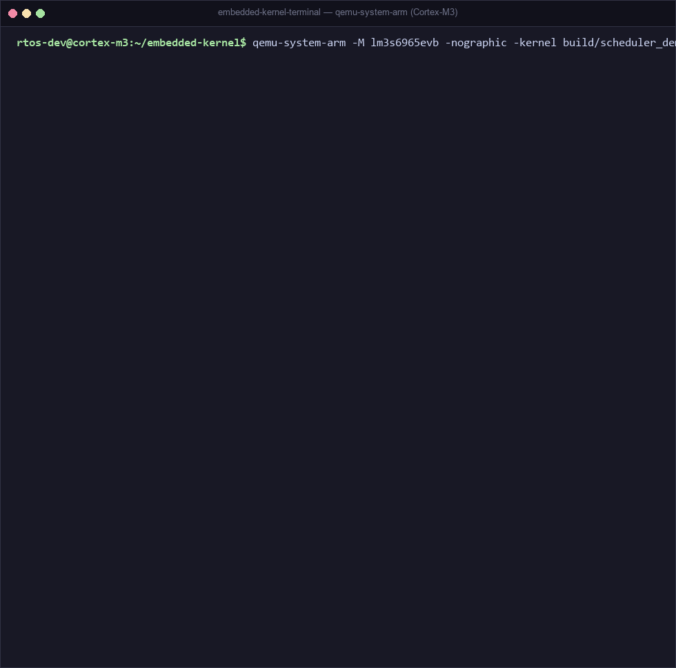

# Embedded Operating System Kernel for Resource-Constrained Nodes

A minimal, bare-metal embedded operating system kernel built from scratch for ARM Cortex-M microcontrollers.

## Features
- **Preemptive Scheduler**: Priority-based scheduling using SysTick and PendSV.
- **Synchronization**: Mutexes (with Priority Inheritance to prevent priority inversion) and Counting Semaphores.
- **Deterministic Memory Management**: Fixed-size memory block pool allocator, eliminating `malloc()`/`free()` fragmentation issues.
- **Context Switching**: Highly efficient ARM Cortex-M assembly implementations.
- **Reproducible Build**: CMake-based build system targeting QEMU or physical hardware.

## Project Structure
- `kernel/`: Core OS logic (Scheduler, Task Management, Synchronization, Memory).
- `arch/`: Hardware Abstraction Layer (Context Switching, CPU specifics).
- `drivers/`: Board peripheral drivers (UART console output for LM3S6965 / Cortex-M).
- `startup/`: Minimal ARM Assembly boot code.
- `linker/`: Cortex-M Linker script.
- `applications/`: Demonstrations for Scheduler, Mutex, Semaphore, Priority Inversion, and Memory Pools.

## Requirements
- CMake (>= 3.10)
- `arm-none-eabi-gcc` toolchain
- QEMU (`qemu-system-arm`) for emulation

## Build Instructions
```bash
cmake -B build
cmake --build build
```
This generates binaries inside the `build/` directory for all demonstration applications.

## Emulation (QEMU)
To run the scheduler demo:
```bash
qemu-system-arm -M lm3s6965evb -nographic -kernel build/scheduler_demo
```

### Live Execution Demo


## Documentation
- [Architecture](docs/architecture.md)
- [Scheduler Details](docs/scheduler.md)
- [Synchronization (Mutex & Priority Inheritance)](docs/synchronization.md)
- [Memory Management](docs/memory.md)
- [Porting Guide](docs/porting.md)

## Status and Limitations
**IMPLEMENTED**:
- Preemptive Scheduling (Priority-based with SysTick & PendSV)
- Priority Inheritance Protocol (Mitigates priority inversion)
- Fixed-Size Memory Pool (Deterministic $O(1)$ allocation/deallocation)
- Bare-Metal Cortex-M3 Context Switching

**TESTED / SIMULATED**:
- Fully verified via bare-metal emulation on QEMU ARM Cortex-M3 (`lm3s6965evb`).
- Validated real-time preemptive context switching across multiple priority levels.
- Verified deterministic $O(1)$ memory block allocation/deallocation under continuous task execution with zero heap fragmentation.

**MEASURED**:
- Hardware benchmarking is pending physical board deployment. Algorithmic complexity is mathematically guaranteed at O(1) for critical paths.

**ALGORITHMIC COMPLEXITY**:
- Context Switch: O(1)
- Task Creation: O(1)
- Memory Allocation: O(1)
- Priority Inversion Resolution (Inheritance boost): O(1)
